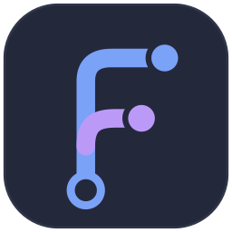

<p align="center">
  
</p>

<h1 align="center">Forkit</h1>

<p align="center">A fast, cross-platform git client that treats worktrees as first-class.<br>Built because every client we tried was too forking slow.</p>

Forkit stays responsive on repositories with very long histories, thousands of branches and tags, and heavy daily activity: the kind that leave other clients staring at a spinner, reconsidering their forking life choices. History is laid out in Go and the window only ever receives the rows on screen. Every open repository is watched, so the UI keeps up with whatever changes on disk.

## Features

- **Worktrees first.** Create a worktree from any branch, tag or remote branch, move between them, and remove them when you're done.
- **A commit graph that scales.** The first screen of history appears while the rest is still streaming in, even on repositories other clients struggle to open.
- **Checkout that understands worktrees.** Forkit asks what to do with uncommitted changes, and offers to switch to the worktree that already has the branch.
- **Live.** Edits, commits, fetches and rebases made outside Forkit show up almost immediately.
- **Observable.** Every action is traced from the click through to each git process it runs. Traces stay on your machine unless you send them somewhere.

## Install

Forkit is pre-release and there are no signed builds yet, which is admittedly forking inconvenient. Build it from source (below). It uses the `git` on your `PATH` (2.36 or newer), or another binary set in Preferences.

## Build from source

You need Go 1.26+, [Bun](https://bun.sh), the [Wails v2 CLI](https://wails.io/docs/gettingstarted/installation) and git 2.36+. On Linux you also need `libgtk-3-dev` and `libwebkit2gtk-4.1-dev`.

```sh
go install github.com/wailsapp/wails/v2/cmd/wails@v2.16.0
wails build                    # on Linux: wails build -tags webkit2_41
open build/bin/Forkit.app      # macOS
```

For development with hot reload, run `wails dev`. See [CONTRIBUTING.md](CONTRIBUTING.md) for tests, performance checks and tracing.

## How it works

Go owns git and the frontend owns pixels:

- **Backend (Go).** Runs the system `git` CLI and builds entities from its output. It lays out history and watches each repository's git dirs and worktrees, then pushes sequenced deltas of everything that changed.
- **Frontend (React + Effect).** Mirrors those deltas into TanStack DB collections and renders them, asking for windows of graph rows as you scroll.
- **One data model.** [`schema/forkit.schema.json`](schema/forkit.schema.json) defines every entity once. Go structs and Effect Schemas are generated from it.

[docs/architecture.md](docs/architecture.md) covers the design in more detail, along with the decisions made so far.

## License

[MIT](LICENSE)
